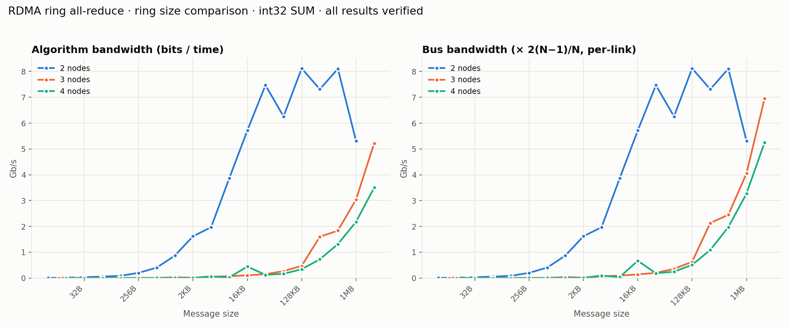
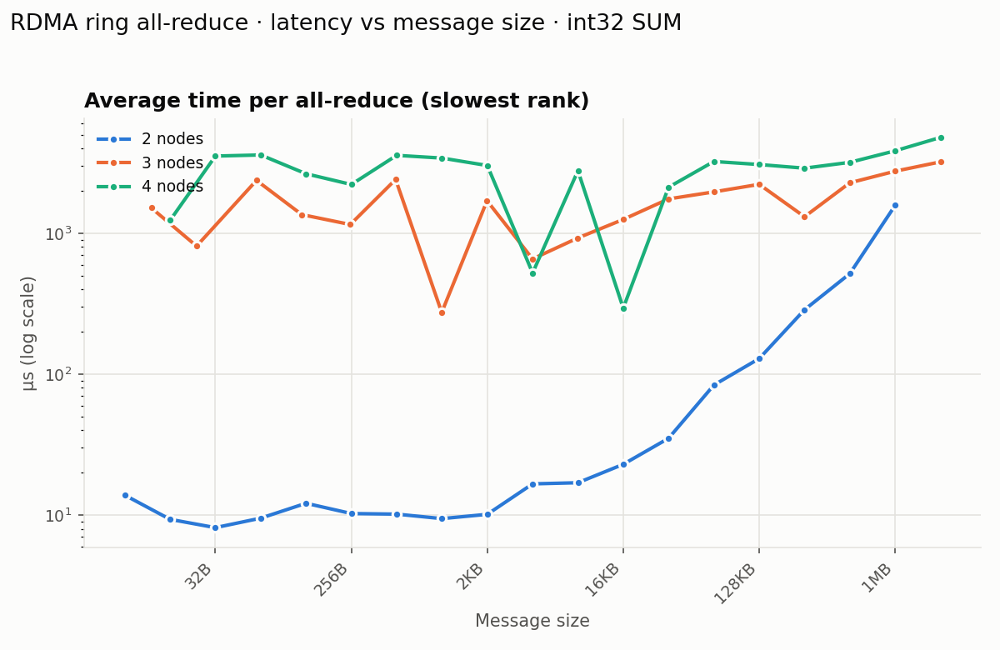

# Exercise 3 – Ring All-Reduce over RDMA: Implementation Report

## 1. Overview

This exercise implements a distributed All-Reduce collective communication primitive over InfiniBand using the Verbs API. The operation combines data from all participating nodes (at least 2, tested with 2, 3 and 4) by applying a reduction operation (SUM, MAX, or MIN) over integer, float, or double arrays, and delivers the identical result to every node. The implementation decomposes All-Reduce into two canonical phases: **Reduce-Scatter** and **All-Gather**, arranged in a logical ring topology, with pipelining applied to the Reduce-Scatter phase to overlap communication and computation.

---

## 2. Ring Topology Design

Each node is assigned an integer rank (0 through N−1). The ring is formed by connecting every node to exactly two neighbors:

- **Right neighbor**: the node at rank `(my_rank + 1) % N` — data is sent to this node.
- **Left neighbor**: the node at rank `(my_rank - 1 + N) % N` — data is received from this node.

This arrangement creates a directed ring where data tokens flow in one direction (left → right), completing a full circuit over N−1 steps. This is the standard basis for bandwidth-optimal ring All-Reduce algorithms.

To support bidirectional RDMA signaling while keeping the send/receive directions clean, **two Queue Pairs (QPs) are created per node**:

| QP | Direction | Purpose |
|----|-----------|---------|
| `left_qp`  | Receives | Accepts data arriving from the left neighbor |
| `right_qp` | Sends    | Pushes data out to the right neighbor |

Both QPs share a single Completion Queue (CQ). This simplifies polling: any call to `ibv_poll_cq` can drain completions from both QPs without needing to distinguish sources.

---

## 3. Connection Establishment

Establishing an RDMA Reliable Connection (RC) requires exchanging QP numbers, LIDs (Local Identifiers), remote memory addresses, and remote keys before the hardware QPs can transition to the Ready-to-Send state. Since RDMA has no built-in bootstrapping layer, this exchange is done out-of-band (OOB) over TCP.

### 3.1 RDMA Resources Allocated

Before any TCP exchange, each node allocates its RDMA resources in the following order:

1. **IB device and active port** – The code iterates over all available InfiniBand devices and selects the first port in `IBV_PORT_ACTIVE` state.
2. **Protection Domain (PD)** – A PD scopes all subsequent memory registrations and QPs.
3. **Memory Region (MR)** – A `MAX_BUF_SIZE` buffer (4 MB by default, overridable with `make MAX_BUF_SIZE=...`) is registered with `IBV_ACCESS_LOCAL_WRITE | IBV_ACCESS_REMOTE_WRITE | IBV_ACCESS_REMOTE_READ`, granting both local and remote processes the right to read and write into this buffer. The resulting `lkey` and `rkey` are used in all subsequent RDMA operations.
4. **Completion Queue (CQ)** – Depth 200, shared by both QPs.
5. **Two QPs** (`left_qp`, `right_qp`) – Created in `IBV_QPT_RC` (Reliable Connection) mode, then immediately transitioned to `IBV_QPS_INIT`.

### 3.2 Out-of-Band (TCP) Coordinate Exchange

The struct exchanged over TCP is:

```c
struct rdma_dest {
    uint64_t vaddr;  // Buffer virtual address
    uint32_t rkey;   // Remote key for RDMA access
    uint32_t qpn;    // Queue Pair Number
    uint32_t psn;    // Packet Sequence Number
    uint16_t lid;    // InfiniBand LID
};
```

All fields are serialized using network byte order (`htonl`, `htobe64`, etc.) to ensure portability across machines.

Each node participates in two pairwise exchanges:

**Exchange with LEFT neighbor** (`exchange_with_left`):
- The current node acts as **TCP server**: binds, listens, and accepts a connection on the OOB port.
- It first reads the left neighbor's `rdma_dest` from the socket.
- It then sends its own `rdma_dest` (advertising `left_qp->qp_num` so the left neighbor can target the correct QP).

**Exchange with RIGHT neighbor** (`exchange_with_right`):
- The current node acts as **TCP client**: connects to the right neighbor's IP and OOB port.
- It first sends its own `rdma_dest` (advertising `right_qp->qp_num`).
- It then reads the right neighbor's `rdma_dest`.

### 3.3 Deadlock Avoidance

A naive approach where every node listens before connecting would deadlock (or at minimum serialize) because all nodes block on `accept()` simultaneously. The solution uses **rank parity to interleave server/client roles**:

- **Even-rank nodes**: listen for the left neighbor first, then connect to the right.
- **Odd-rank nodes**: connect to the right neighbor first, then listen for the left.

This ensures that for every pair of adjacent nodes, one is always in client mode and one in server mode at any given moment, eliminating any circular wait.

### 3.4 QP State Transitions

After the TCP exchange, each QP is driven through the standard RC state machine:

```
RESET → INIT → RTR → RTS
```

- **INIT**: Sets port number, pkey index, and access flags.
- **RTR** (Ready to Receive): Sets the remote QP number, LID, path MTU, receive PSN, and address handle targeting the remote node's `lid`. The QP is now able to receive incoming messages.
- **RTS** (Ready to Send): Sets the local send PSN, timeout, retry counts, and RNR retry count. The QP is now fully operational.

All four QPs (two per node — `left_qp` and `right_qp`) are transitioned to RTS before any data movement begins.

### 3.5 Pairwise Hardware-Ready Barrier

Even after all QPs are in RTS, a brief TCP barrier is performed to ensure all nodes are synchronized before the first RDMA operation is issued. Each node:

1. Sends a 1-byte `READY` token to both neighbors over the existing TCP sockets.
2. Reads a 1-byte `READY` token from both neighbors.

Only after both tokens are received are the TCP sockets closed. This guarantees that no node begins issuing RDMA operations before all ring members have their QPs in RTS, preventing race conditions in the first communication step.

---

## 4. Reduce-Scatter Phase with Pipelining

### 4.1 Algorithm

The input array of `count` elements is divided evenly into `N` chunks, one per node. Each chunk has `chunk_elems = count / N` elements. Over `N−1` steps, each node:

1. Sends one chunk clockwise to its right neighbor.
2. Receives one chunk from its left neighbor.
3. Reduces (adds, takes max, or takes min) the received chunk into its local copy of that chunk.

After `N−1` steps, each node holds the fully-reduced result for exactly one chunk (its "owned" chunk).

### 4.2 Double-Buffered Pipeline

Without pipelining, each step would serialize: post receive → wait → reduce → post send → wait. This is wasteful because the network hardware sits idle during computation and vice versa.

The implementation uses **double-buffered pipelining** to overlap the three activities:

```
Step k:   [ Receive k ] [ Send k ] concurrent with...
Step k+1:     [ Reduce k ] [ Receive k+1 ] [ Send k+1 ]
```

Two scratch receive buffers are allocated at the end of the registered MR:

```
[  main data (N chunks)  ][ scratch_buf[0] ][ scratch_buf[1] ][ sync_byte ]
```

The pipeline operates as follows:

**Priming (Step 0)**:
- Post the first receive into `scratch_buf[0]`.
- Post the first send (node's own chunk).
- Both are in flight simultaneously.

**Main loop (Steps 1 through N−1)**:

For each step:

1. **Poll** for the previous step's receive completion and send completion.
2. **Post the next receive** (into `scratch_buf[step % 2]`) immediately — this starts the next network transfer while computation happens below.
3. **Reduce** the data that just arrived in `scratch_buf[(step-1) % 2]` into the appropriate chunk in the main buffer.
4. **Post the next send** of the just-reduced chunk — this chunk is now available for the right neighbor to reduce further.

Steps 2, 3, and 4 of iteration `k` overlap with the network transfer initiated in step 2. The alternating `step % 2` index on the scratch buffers ensures that while one buffer is being reduced (step 3), the other is being written to by the network (step 2), with no conflict.

### 4.3 Transport Used

Reduce-Scatter uses **IBV_WR_SEND / ibv_post_recv**: a two-sided operation where the receiver must have posted a receive buffer before the sender issues the send. This is appropriate here because the receiver (each node's `left_qp`) does not know in advance at which address the sender will write — the sender is the one choosing what to send, and the receiver buffers into scratch space before inspecting the data.

---

## 5. All-Gather Phase with RDMA Write (Zero-Copy)

### 5.1 Algorithm

After Reduce-Scatter, each node holds the final reduced value for one chunk. All-Gather disseminates every chunk to all nodes. Over `N−1` steps, each node broadcasts its owned chunk (and previously received chunks) clockwise around the ring.

### 5.2 RDMA Write for Zero-Copy

The All-Gather phase uses **IBV_WR_RDMA_WRITE** — a one-sided operation where the sender places data directly into the remote node's registered buffer at a known remote virtual address. No matching receive needs to be posted at the destination; the data lands in-place without any CPU involvement on the receiver side.

The remote virtual address is computed precisely:

```c
remote_vaddr = handle->right_remote_dest.vaddr + (send_chunk_idx * chunk_bytes);
```

Because all nodes share the same buffer layout (the main data starts at offset 0 within each node's MR), and every node exchanged its `vaddr` during connection setup, each sender knows exactly where in the right neighbor's buffer to write each chunk.

This avoids a CPU-to-CPU copy at the receiver: the data from the RDMA Write lands directly at its final destination in `recvbuf`'s layout, satisfying the "large message zero-copy" requirement.

### 5.3 Synchronization Signal

RDMA Write is silent at the destination — the remote CPU receives no notification when the write completes. A 1-byte **synchronization signal** is therefore sent over the two-sided `right_qp` to notify the right neighbor that the RDMA Write for this step has been issued. Each All-Gather step does three things concurrently:

1. Post a receive for the 1-byte sync signal from the left neighbor.
2. Post the RDMA Write of the chunk data to the right neighbor.
3. Post a 1-byte send (sync signal) to the right neighbor.

Then wait for all three completions before advancing. The sync signal acts as a lightweight sequencing primitive that ensures a node does not proceed to the next step before both the data arrival (RDMA Write from the left) and the send (RDMA Write to the right) have completed.

---

## 6. Buffer Memory Layout

All RDMA-accessible memory lives in a single registered buffer of `MAX_BUF_SIZE` bytes (4 MB by default) (`handle->buf`). The layout during `pg_all_reduce` is:

```
Offset 0:
┌────────────────────────────────────────────────────┐
│  Chunk 0  │  Chunk 1  │  ...  │  Chunk N-1        │  ← main data (N * chunk_bytes)
├───────────┼───────────┤
│ scratch[0]│ scratch[1]│  sync │                   │  ← reduce-scatter scratch + sync byte
└───────────┴───────────┴───────┴───────────────────┘
```

This single-registration design avoids the overhead of registering additional memory regions at runtime, keeps all RDMA keys consistent, and allows RDMA Write to target precise offsets within the main data region.

---

## 7. API Design

The public interface matches the exercise specification:

| Function | Description |
|----------|-------------|
| `connect_process_group(servername, rank, num_nodes, pg_handle, oob_port)` | Allocates RDMA resources, establishes ring connections via TCP OOB exchange, brings all QPs to RTS, and synchronizes all nodes. |
| `pg_all_reduce(sendbuf, recvbuf, count, datatype, op, pg_handle)` | Executes the two-phase ring All-Reduce: pipelined Reduce-Scatter followed by RDMA Write All-Gather. |
| `pg_close(pg_handle)` | Destroys all QPs, CQ, MR, PD, and device context; frees all memory. |

The opaque `pg_handle` passed between calls is internally a `struct pg_handle_t` that carries all RDMA objects, remote destination metadata, rank, and node count. Callers treat it as a `void *`, keeping the API clean.

---

## 8. Summary of Key Design Decisions

| Decision | Choice Made | Rationale |
|----------|-------------|-----------|
| Ring QP model | Two QPs per node (left/right) | Cleanly separates send/receive paths; avoids self-loop QP |
| OOB bootstrap | TCP with rank-parity ordering | Simple, reliable; parity interleaving prevents deadlock |
| Reduce-Scatter transport | Two-sided SEND/RECV | Receiver controls buffer; correct for scatter into scratch space |
| Reduce-Scatter pipelining | Double-buffered with next-recv posted before compute | Overlaps network and CPU; doubles effective bandwidth utilization |
| All-Gather transport | One-sided RDMA WRITE | Zero-copy; data lands in-place at final destination |
| All-Gather synchronization | 1-byte TCP-style send over RDMA | Lightweight; notifies receiver without extra memory registration |
| Completion detection | Busy-poll (`ibv_poll_cq`) | Lowest latency; appropriate for HPC workloads |
| Supported types | INT, FLOAT, DOUBLE × SUM, MAX, MIN | Matches exercise `DATATYPE` and `OPERATION` enumerations |

---

## 9. Performance Evaluation

### 9.1 Setup and Methodology

The benchmark is built into `rdma_allreduce` and driven by `run_benchmark.sh all`, which runs rings of 2, 3 and 4 nodes on `mlx-stud-01` … `mlx-stud-04` (rank *i* on `mlx-stud-0(i+1)`). The numbers below come from the run in `results/all_20261015_144736/`.

- **Operation**: `TYPE_INT`, `OP_SUM`.
- **Message sizes**: powers of two, rounded down to a multiple of `N` integers so that every node gets an equal chunk (for example, the "16 B" row of the 3-node ring is really 12 B). The sweep stops at the largest message that fits in the 4 MB registered buffer together with the two scratch chunks and the sync byte: 1 MB for 2 nodes and 2 MB for 3 and 4 nodes.
- **Timing**: 5 warm-up calls, then a timed loop sized to take about 0.5 s (between 5 and 1000 iterations). Each rank measures its own average time per call, and the reported time is the **slowest rank's** average, gathered with an `OP_MAX` all-reduce.
- **Bandwidth**: algorithm bandwidth `AlgBW = bytes × 8 / time`; bus bandwidth `BusBW = AlgBW × 2(N−1)/N`, the data each link actually carries in a ring all-reduce, which makes rings of different sizes comparable.
- **Correctness**: every node fills `sendbuf[i] = rank + (i mod 1000)` and checks after every size that `recvbuf[i] = N(N−1)/2 + N·(i mod 1000)`. All sizes on all ring sizes passed with 0 wrong elements.

### 9.2 Bandwidth



*Figure 1 – Algorithm bandwidth (left) and bus bandwidth (right) against message size. For N = 2 the factor 2(N−1)/N is 1, so the two are equal.*

### 9.3 Latency



*Figure 2 – Average time per all-reduce call (slowest rank), log scale.*

### 9.4 Results Table

| Size | 2 nodes: time (µs) | 2 nodes: BusBW (Gb/s) | 3 nodes: time (µs) | 3 nodes: BusBW (Gb/s) | 4 nodes: time (µs) | 4 nodes: BusBW (Gb/s) |
|---:|---:|---:|---:|---:|---:|---:|
| 8 B | 13.9 | 0.005 | — | — | — | — |
| 16 B | 9.3 | 0.014 | 1,516.6 | 0.000 | 1,236.3 | 0.000 |
| 32 B | 8.2 | 0.031 | 812.0 | 0.000 | 3,535.5 | 0.000 |
| 64 B | 9.5 | 0.054 | 2,375.6 | 0.000 | 3,600.4 | 0.000 |
| 128 B | 12.1 | 0.084 | 1,358.2 | 0.001 | 2,647.6 | 0.001 |
| 256 B | 10.3 | 0.200 | 1,155.1 | 0.002 | 2,221.7 | 0.001 |
| 512 B | 10.2 | 0.403 | 2,412.6 | 0.002 | 3,577.7 | 0.002 |
| 1 KB | 9.4 | 0.867 | 274.6 | 0.040 | 3,420.6 | 0.004 |
| 2 KB | 10.1 | 1.617 | 1,703.6 | 0.013 | 3,030.3 | 0.008 |
| 4 KB | 16.7 | 1.966 | 658.1 | 0.066 | 523.1 | 0.094 |
| 8 KB | 17.0 | 3.860 | 927.3 | 0.094 | 2,781.3 | 0.035 |
| 16 KB | 22.9 | 5.713 | 1,254.9 | 0.139 | 294.6 | 0.667 |
| 32 KB | 35.1 | 7.468 | 1,755.0 | 0.199 | 2,124.3 | 0.185 |
| 64 KB | 83.8 | 6.257 | 1,968.6 | 0.355 | 3,236.6 | 0.243 |
| 128 KB | 129.1 | 8.119 | 2,227.3 | 0.628 | 3,078.8 | 0.511 |
| 256 KB | 286.8 | 7.312 | 1,311.8 | 2.132 | 2,900.5 | 1.085 |
| 512 KB | 517.6 | 8.104 | 2,284.1 | 2.448 | 3,190.7 | 1.972 |
| 1 MB | 1,579.6 | 5.311 | 2,760.9 | 4.051 | 3,852.3 | 3.266 |
| 2 MB | — | — | 3,215.7 | 6.956 | 4,794.4 | 5.249 |

*Table 1 – Average time per call and bus bandwidth. "—" means that size was not part of that ring's sweep. Full per-run data, including iteration counts and algorithm bandwidth, is in `results/all_20261015_144736/<N>nodes/allreduce_results.csv`.*

Per-ring charts are also available: [2 nodes](results/all_20261015_144736/2nodes/allreduce_results.png), [3 nodes](results/all_20261015_144736/3nodes/allreduce_results.png), [4 nodes](results/all_20261015_144736/4nodes/allreduce_results.png).

### 9.5 Observations

1. **Two nodes behave as expected.** Up to 2 KB the time stays flat at about 8–14 µs, so small messages are bound by per-operation latency. From 4 KB on, bandwidth rises quickly and levels off at about **8.1 Gb/s** (128 KB and 512 KB), where the link is the bottleneck. The drop to 5.3 Gb/s at 1 MB comes from a single measurement and would need repeated runs before drawing conclusions.

2. **Three and four nodes have a millisecond-scale floor.** Messages of 2 KB and below take 0.3–3.6 ms on 3 and 4 nodes (mostly above 1 ms), roughly 30–380× the 2-node time for the same size, and the times jump erratically between neighboring sizes (on 4 nodes: 16 KB takes 295 µs while 32 KB takes 2,124 µs). This is not a bandwidth limit: the time barely depends on message size until the largest messages. Instead, individual steps are stalling. The likely difference from the 2-node case: there, each node's left and right neighbors are the same node, so the two ranks stay in lockstep. With three or more nodes, a rank can issue its two-sided SEND before its right neighbor has posted the matching RECV, which makes the sender back off and retry (RNR). Lowering `MIN_RNR_TIMER` from 12 (0.64 ms) to 1 (0.01 ms) already helped, but the remaining stalls are much longer than one RNR delay, so the cause is not fully pinned down yet. The lab machines are shared, and each size was timed only 96–506 times on these rings, so some of the noise may also come from outside the benchmark.

3. **Large messages amortize the stall.** As messages grow, the fixed overhead matters less: on 3 nodes bus bandwidth climbs to **6.96 Gb/s** at 2 MB, and on 4 nodes to **5.25 Gb/s**. Both curves are still rising at the end of the sweep, so the 4 MB registered buffer, not the network, sets the limit here. Building with a larger buffer (`make MAX_BUF_SIZE=67108864`) would show where they level off.

4. **Correctness held everywhere.** Every size on every ring returned the exact expected sum on all ranks, including the 3-node sizes, which are not powers of two.
